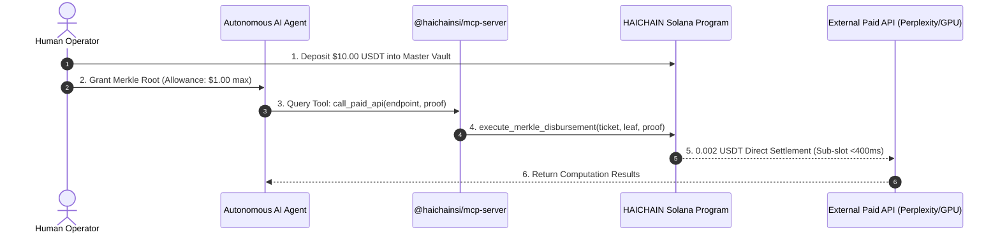

# HAICHAIN Developer Quickstart Guide
**Autonomous Micro-Escrows & High-Frequency Machine-to-Machine Payments in 60 Seconds**

Version: 1.0.0 | Network: Solana Devnet / Mainnet-Beta | Runtime: Node.js 18+ / Bun / Deno

---

## 1. Overview
HAICHAIN provides an un-griefable, sub-cent payment pipeline designed specifically for autonomous AI agents (ElizaOS, CrewAI, AutoGen, LangChain, Cursor, Claude Desktop). 

Instead of exposing human credit cards or giving raw private keys to LLMs, agents transact through **One-Time Merkle Capability Tickets** verified directly on-chain by the HAICHAIN Solana Core Program.



---

## 2. Installation & 1-Click Setup

### A. 1-Click MCP Setup for Claude Desktop & Cursor
To instantly hook up HAICHAIN into your Claude Desktop or Cursor AI agents without manual JSON editing:

```bash
# In the HAICHAIN repository root:
npm run install:mcp
```
This automatically registers the compiled `@haichainsi/mcp-server` into `%APPDATA%/Claude/claude_desktop_config.json` (Windows) or `~/.config/Claude/` (macOS/Linux). Restart Claude Desktop and you will see all HAICHAIN tools live!

### B. Starting the Live Solana Devnet Faucet & Gasless Relayer
To test on-chain settlements with real Devnet SOL sponsorship:

```bash
npm run start:relayer
# Server will listen on http://localhost:3001
# Test endpoint: http://localhost:3001/api/health
# Real Faucet API: http://localhost:3001/api/faucet
```

### C. SDK Installation from Source / NPM
```bash
# Build the TypeScript Client SDK:
npm run build --prefix sdk/typescript

# Run 100% Forensic Security & Enterprise SLA Tests:
node ./node_modules/mocha/bin/mocha.js --require ts-node/register tests/haichain-security.test.ts tests/haichain-v7-sla-enterprise.test.ts
```

---

## 3. Quickstart: 3 Simple Steps

### Step 1: Initialize Vault & Master Session
```typescript
import { Connection, Keypair } from "@solana/web3.js";
import { HaiChainClient } from "@haichain/sdk";

// Connect to Solana Devnet or Mainnet-Beta
const connection = new Connection("https://api.devnet.solana.com", "confirmed");
const masterOwner = Keypair.generate(); // Your funded operator wallet

const client = new HaiChainClient({
  connection,
  masterOwner,
  network: "devnet"
});

// Initialize master vault with quarantine protection
const vaultAddress = await client.initializeVault({
  stablecoinMint: "Es9vMFrzaCERmJfrF4H2FYD4KCoNkY11McCe8BenwNYB", // USDT
  depositAmount: 10_000_000 // 10.00 USDT (6 decimals)
});

console.log(`Vault deployed at: ${vaultAddress.toBase58()}`);
```

### Step 2: Generate Ephemeral Capability Ticket for AI Agent
```typescript
// Define spend bounds for the sub-agent
const capability = {
  maxSpendMicroUsdt: 50_000,    // Max 0.05 USDT
  expirySlotDelta: 1000,        // Expires in ~7 minutes
  allowedProviderAta: "ProviderTokenAccountPubkey..."
};

// Generate cryptographic Merkle ticket
const ticket = client.issueCapabilityTicket(capability);
console.log("Ticket issued for Agent:", ticket.nonce);
```

### Step 3: Connect to Claude Desktop or Cursor via MCP
Add HAICHAIN to your Claude Desktop configuration (`claude_desktop_config.json`):

```json
{
  "mcpServers": {
    "haichain": {
      "command": "node",
      "args": [
        "c:/Users/Surface/Documents/8. HAICHAIN/mcp-server/dist/index.js"
      ],
      "env": {
        "SOLANA_RPC_URL": "https://api.devnet.solana.com",
        "HAICHAIN_PROGRAM_ID": "HaiChainCore11111111111111111111111111111111"
      }
    }
  }
}
```

Now, Claude or your agent can autonomously execute:
- `haichain_check_balance`: Inspect available agent allowance.
- `haichain_disburse_payment`: Pay 0.001 USDT for downstream LLM inference or GPU tokens.
- `haichain_emergency_panic`: Lock down funds immediately if anomalous tool behavior is detected.

---

## 4. Security Guarantees
- **Zero Raw Key Risk:** The agent never touches the master seed phrase or private key.
- **Double-Spend Replay Defense:** Ephemeral Nullifier PDAs ensure each capability ticket executes exactly once.
- **100% Recyclable Rent:** All rent lamports from expired payment nonces are reclaimed automatically to the human operator.
- **Sub-slot Settlement:** Micro-escrow transfers confirm in under 400 milliseconds on Solana.

---

*For full technical architecture, consult the [Architecture Specification](HAICHAIN_TECHNICAL_ARCHITECTURE_SPECIFICATION.md) and [Official Whitepaper v1.0](HAICHAIN_WHITEPAPER_V1.0_EN.md).*
