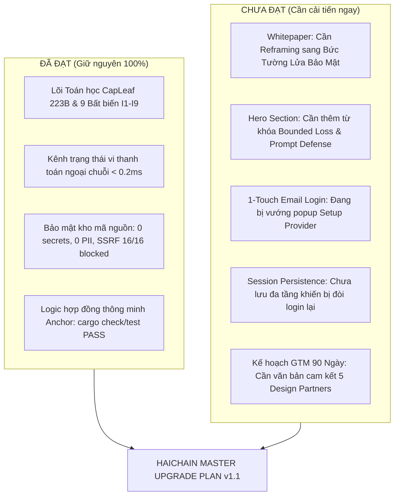

# HAICHAIN MASTER UPGRADE PLAN v1.1
## KẾ HOẠCH TRIỂN KHAI CẢI TIẾN TOÀN DIỆN HỆ THỐNG HAICHAIN
**Đơn vị thực hiện:** Hội đồng Kiến trúc Hệ thống HAICHAIN  
**Ngày ban hành:** 08 tháng 11 năm 2026  
**Trạng thái tài liệu:** Chính thức phê duyệt (Approved Master Plan)  
**Tài sản bảo chứng:** USDT (Solana SPL) & Kênh vi thanh toán x402 / CapLeaf Invariants $I_1 - I_9$  

---

## 1. TRIẾT LÝ ĐỊNH VỊ: "TẦM NHÌN LỚN & MŨI KHOAN NHỌN THỰC CHIẾN"
Kế hoạch này kết hợp hoàn hảo giữa **Tầm nhìn vĩ đại (The Grand Vision)** để truyền cảm hứng cho cộng đồng, nhà đầu tư thể chế và **Mũi khoan nhọn thực chiến (The Sharp Wedge / Trojan Horse)** để các kỹ sư AI, doanh nghiệp chấp nhận cài đặt và sử dụng ngay lập tức:

1. **Tầm nhìn Tối cao (The Grand Vision - Giữ nguyên 100%):**
   * **Badge:** `THE FINANCIAL OPERATING SYSTEM FOR THE AUTONOMOUS MACHINE ERA` / `HỆ ĐIỀU HÀNH TÀI CHÍNH CHO KỶ NGUYÊN MÁY TỰ HÀNH`
   * **Title:** `The Economic Bedrock for the Symbiotic Superintelligence Era AI²` / `Nền Tảng Kinh Tế Cho Kỷ Nguyên Siêu Trí Tuệ Cộng Sinh AI²`
   * **Ý nghĩa:** Khẳng định vị thế người tiên phong, xây dựng nền tảng kinh tế trường tồn cho sự cộng sinh giữa Con người (Human) và Siêu trí tuệ (AI).
2. **Mũi khoan nhọn Thực chiến (The Sharp Wedge - Bổ sung trực diện):**
   * **Subtitle:** *"Bức tường lửa tài chính tự hành cho AI Agent — Giới hạn rủi ro hữu hạn (Bounded Loss), Bất biến ngân sách & Miễn nhiễm rút ruột ví khi bị Prompt Injection."*
   * **Khẩu hiệu kỹ thuật:** `Prompt Injection Defense • Bounded Loss • Zero-Drain Wallet • Budget Firewall`.
   * **Ý nghĩa:** Giải quyết đúng tử huyệt lớn nhất của thị trường hiện nay: *Các doanh nghiệp sợ cấp ví cho AI vì lo ngại một câu prompt ác ý sẽ rút sạch ngân quỹ công ty.*

---

## 2. BÁO CÁO PHÂN TÍCH ĐẠT & CHƯA ĐẠT (GAP ANALYSIS)



### 2.1. Những điểm ĐẠT (Tài sản kỹ thuật cốt lõi được bảo toàn)
* **Lõi Toán học & Mật mã học:** Cấu trúc CapLeaf 223 bytes wire format, 9 Bất biến an ninh $I_1 - I_9$ trên Solana L1, PolicyEngine Out-of-process, và Watchtower Sentinel daemon.
* **Độ sạch & An toàn Repo:** Toàn bộ kho lưu trữ sạch hoàn toàn secrets và PII nhà đầu tư; bộ lọc SSRF chặn đứng 16/16 vector tấn công; rate limit 5 req/15m; giấy phép mã nguồn mở MIT License.
* **Bộ kiểm thử toàn diện:** 92/92 TypeScript Mocha tests pass, 9/9 Python unit tests pass, và 10/10 stage Devnet verification pass.

### 2.2. Những điểm CHƯA ĐẠT & Nguyên nhân (Root Causes)
1. **Lớp áo định vị Whitepaper còn mang tính đối đầu:** Tự nhận là "L1 thay thế Stripe/Bittensor" khiến các nhà thẩm định hoài nghi vì quy mô thị trường x402 hiện tại còn nhỏ ($274k/tháng).  
   $\rightarrow$ *Giải pháp:* Định vị lại Haichain thành **Lớp Adapter Bảo mật & Quản trị Ngân sách (Security & Governance Adapter)** cắm vào Stripe MPP, Coinbase AgentKit, Claude Desktop và ElizaOS.
2. **Hero Landing Page chưa thể hiện công cụ giải quyết nỗi sợ mất tiền:** Người xem chưa thấy ngay giải pháp ngăn Prompt Injection trong 3 giây đầu.  
   $\rightarrow$ *Giải pháp:* Giữ nguyên Badge và Title, nâng cấp Subtitle và 3 Pills tính năng bảo vệ ví.
3. **Trải nghiệm Email Đăng nhập 1-chạm bị vướng Popup Setup Provider:** Link trong email hiện tại không kèm tham số nhận diện phiên (`autoConnect`, `wallet`), đồng thời trình duyệt In-app của Gmail/Outlook không chia sẻ `localStorage` khiến phiên làm việc bị mất.  
   $\rightarrow$ *Giải pháp:* Cấu hình Magic Link Deep-link tự động nhận diện và lưu phiên đa tầng (`localStorage` + `sessionStorage` + `Cookie 30 ngày`).

---

## 3. LỘ TRÌNH TRIỂN KHAI CHI TIẾT (ACTION PHASES)

### GIAI ĐOẠN 1: CẢI TIẾN TRẢI NGHIỆM ĐĂNG NHẬP 1-CHẠM (UX & AUTH FIX)
* **Mục tiêu:** Bấm vào link trong email là vào thẳng Dashboard với tư cách chủ nhân, bỏ qua 100% các bước setup provider, không bao giờ bị hỏi đăng nhập lại.
* **Tệp chỉnh sửa:**
  1. `dashboard.html` & `app/dashboard.html`
  2. `server/haichain-mcp-worker.js` & `server/production-agent-relayer.js`
* **Hành động cụ thể:**
  * **Chuẩn hóa Magic Link trong email:**
    ```html
    <a href="https://haichain.si/dashboard?tab=vesting&autoConnect=1&wallet=${wallet}&provider=biometric&auth_sig=${authSig}">
      Mở Khoản Phân Bổ & Hũ Tiền Của Bạn
    </a>
    ```
  * **Cơ chế Bỏ qua Setup Provider trên Dashboard:**
    * Khi URL chứa `autoConnect=1` hoặc `wallet=...`:
      * Tự động gọi `setConnectedWallet(wallet, 'Passkey Biometric')`.
      * Tự động ẩn toàn bộ modal `ai-provider-modal` và `wallet-connect-modal`.
      * Lưu trạng thái đăng nhập đồng thời vào:
        1. `localStorage.setItem('haichain-connected-wallet', ...)`
        2. `sessionStorage.setItem('haichain-connected-wallet', ...)`
        3. `document.cookie = "haichain_wallet=" + wallet + "; path=/; max-age=2592000; SameSite=Lax"` (Lưu 30 ngày).
    * Khi người dùng mở lại trang sau vài tiếng hoặc vài ngày, hàm `onTabWakeup()` sẽ đọc Cookie và LocalStorage để tự phục hồi phiên làm việc lập tức.

---

### GIAI ĐOẠN 2: NÂNG CẤP HERO SECTION & ĐỘNG CƠ ĐA NGÔN NGỮ (I18N)
* **Mục tiêu:** Giữ vững Badge và Title, truyền tải thông điệp Bức tường lửa Bounded Loss & Prompt Injection Defense.
* **Tệp chỉnh sửa:**
  1. `index.html` & `app/index.html`
  2. `i18n.js` (cập nhật đồng bộ cả 10 ngôn ngữ: EN, VI, ZH, FR, ES, RU, KO, HI, HE, KK)
* **Nội dung chuỗi hiển thị chuẩn:**
  * **`hero.badge` (Giữ nguyên):**
    * *EN:* `THE FINANCIAL OPERATING SYSTEM FOR THE AUTONOMOUS MACHINE ERA`
    * *VI:* `HỆ ĐIỀU HÀNH TÀI CHÍNH CHO KỶ NGUYÊN MÁY TỰ HÀNH`
  * **`hero.title` (Giữ nguyên):**
    * *EN:* `The Economic Bedrock for the Symbiotic Superintelligence Era AI²`
    * *VI:* `Nền Tảng Kinh Tế Cho Kỷ Nguyên Siêu Trí Tuệ Cộng Sinh AI²`
  * **`hero.subtitle` (Nâng cấp thực chiến):**
    * *EN:* `The Autonomous Financial Firewall for AI Agents. Enforcing deterministic Merkle CapLeaf invariants, bounded-loss spending limits, and prompt-injection immunity to prevent catastrophic wallet drainage.`
    * *VI:* `Bức tường lửa tài chính tự hành cho AI Agent. Thiết lập bất biến ngân sách Merkle CapLeaf, giới hạn rủi ro hữu hạn (Bounded Loss) và miễn nhiễm rút ruột ví khi AI bị tấn công Prompt Injection.`
  * **Bổ sung 3 Feature Trust Badges ngay dưới nút bấm CTA:**
    * 🛡️ **Zero-Drain Budget Firewall** (Chống Rút Ruột Ví Khi Bị Hack Prompt)
    * ⚡ **Sub-Second Panic Kill-Switch** (Cầu Chì Thu Hồi Vốn Dưới 1 Giây)
    * 🔌 **Universal x402 & MCP Adapter** (Tương Thích Tuyệt Đối Coinbase x402 & Anthropic MCP)

---

### GIAI ĐOẠN 3: ĐIỀU CHỈNH LỚP ÁO ĐỊNH VỊ SÁCH TRẮNG (WHITEPAPER REFRAMING)
* **Mục tiêu:** Giữ nguyên 100% phần toán học và mật mã học; tinh chỉnh 15% phần định vị từ "Đối thủ đối đầu" thành "Lớp Adapter Bảo mật & Thực thi Chính sách".
* **Tệp chỉnh sửa:**
  1. `HAICHAIN_WHITEPAPER_V1.0_VI.md` (Bản Tiếng Việt)
  2. `HAICHAIN_WHITEPAPER_V1.0_EN.md` (Bản Tiếng Anh)
* **Các điểm điều chỉnh:**
  * **Abstract:** Định vị Haichain là *Kiến trúc Bức tường lửa Quản trị Ngân sách Hữu hạn (Bounded Loss) cho AI Tự trị*, đặt nền móng tiến hóa thành Hệ điều hành kinh tế máy móc.
  * **Bảng Định vị Chương 1:**
    * Coinbase AgentKit / Stripe MPP = Cung cấp cổng tiền & đường ray thẻ.
    * Haichain = Bức tường lửa khống chế trần rủi ro, ngăn chặn Prompt Injection và kích hoạt Panic Retraction tức thì.
  * **Roadmap 2 Tầng (Chương 9 & 11):**
    * *Tầng 1 (Wedge hiện tại):* Bức tường lửa ngân sách & Kênh vi thanh toán thực chiến trên Solana L1.
    * *Tầng 2 (Endgame dài hạn):* Sovereign L1 chuyên biệt cho máy móc với cơ chế đồng thuận Proof of Actual Intelligence (PoAI).

---

### GIAI ĐOẠN 4: BAN HÀNH KẾ HOẠCH THỰC CHIẾN 90 NGÀY (GTM EXECUTION)
* **Mục tiêu:** Tạo tệp `HAICHAIN_90_DAY_EXECUTION_PLAN.md` để đo lường Product-Market Fit (PMF) bằng số liệu thực tế.
* **Nội dung cam kết:**
  1. **5 Design Partners mục tiêu:**
     * 2 Framework mã nguồn mở: ElizaOS (ai16z plugin) và CrewAI / LangChain.
     * 2 Nhà cung cấp dịch vụ MCP Server trả phí (Smithery, Glama).
     * 1 Đội ngũ phát triển AI Agent tự hành có nhu cầu giới hạn ngân sách chi tiêu.
  2. **Bộ 3 câu hỏi phỏng vấn chuẩn mực:**
     * *"Nỗi sợ lớn nhất của bạn khi cấp ví tiền cho AI agent tự tiêu là gì?"*
     * *"Các giải pháp kiểm soát hiện tại của bạn đã từng bị lọt lưới bởi Prompt Injection chưa?"*
     * *"Bạn có sẵn sàng dùng một SDK mã nguồn mở gọn nhẹ để bọc ví với hạn mức cứng không?"*
  3. **2 Tiêu chí thành công / Tiêu chí Dừng (Stop Criteria):**
     * *Tiêu chí thành công:* Tối thiểu 3 đối tác tích hợp `@haichainsi/sdk` vào production và xử lý > $10.000 giao dịch kiểm soát an toàn.
     * *Tiêu chí dừng/chuyển hướng (Pivot):* Nếu sau 90 ngày không đối tác nào có nhu cầu dùng relayer chuyên dụng, dự án sẽ tinh gọn thành một thư viện middleware độc lập (Client-side Library).

---

## 4. MA TRẬN KIỂM CHỨNG & TIÊU CHUẨN HOÀN THÀNH (VERIFICATION MATRIX)

| Bước | Hạng mục kiểm tra | Tiêu chuẩn ĐẠT |
| :--- | :--- | :--- |
| **V1** | **Khởi động Magic Link 1-chạm** | Mở link có tham số `wallet`, trang web lập tức hiển thị trạng thái đã kết nối, không bật bất kỳ modal Setup Provider nào. |
| **V2** | **Lưu phiên đa tầng** | Đóng trình duyệt, mở lại sau 30 phút hoặc mở từ tab ẩn danh có cookie, tài khoản vẫn giữ nguyên trạng thái kết nối. |
| **V3** | **Hiển thị Hero Section** | Badge và Title giữ nguyên vẹn; Subtitle và Feature Pills hiển thị chuẩn xác các từ khóa Bounded Loss & Prompt Defense trên cả 10 ngôn ngữ. |
| **V4** | **Toàn vẹn Sách Trắng** | Nội dung toán học các Bất biến $I_1 - I_9$ và bảng cân đối wire format 223B không bị thay đổi. |
| **V5** | **Kiểm thử Hợp đồng Thông minh** | `cargo check`, `cargo test`, `npm test` (92 tests) và `python -m unittest` (9 tests) tiếp tục đạt kết quả 100% PASS. |

---

> [!NOTE]
> Kế hoạch này được lưu trữ chính thức tại tệp [HAICHAIN_MASTER_UPGRADE_PLAN_V1.1.md](file:///c:/Users/Surface/Documents/8.%20HAICHAIN/HAICHAIN_MASTER_UPGRADE_PLAN_V1.1.md) trong kho lưu trữ dự án để phục vụ công tác theo dõi, triển khai và kiểm toán.
