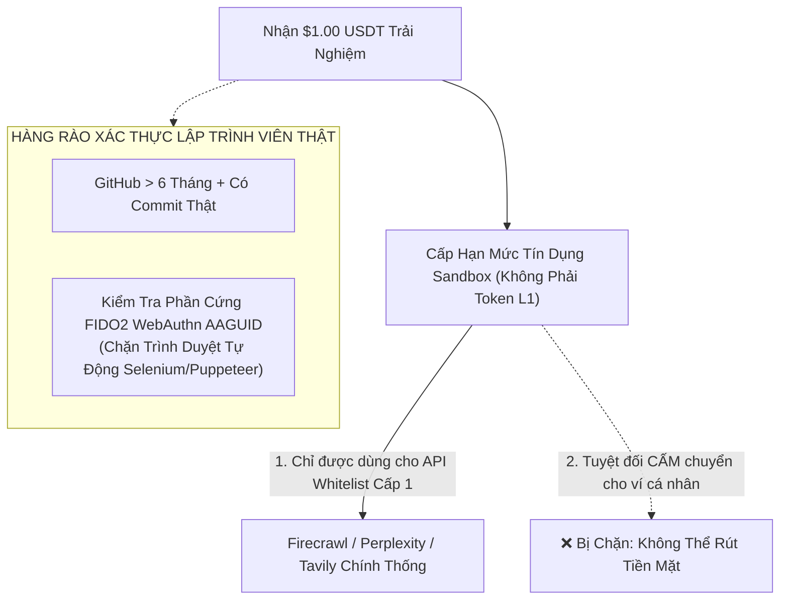

# HỒ SƠ TÁI KIỂM TOÁN TẬN CÙNG: TÂM LÝ KHÁCH HÀNG, CHỐNG SYBIL & TIÊU CHUẨN DOANH NGHIỆP - GIAI ĐOẠN 5
## HAICHAIN FORENSIC ENTERPRISE ADOPTION, SYBIL FAUCET DEFENSE & RUNAWAY LOOP RESILIENCE
**Cơ quan thực hiện:** Hội đồng Giám sát Trải nghiệm Sản phẩm & Thương mại Hóa Quy mô Toàn cầu (Tier-1 Product-Led Growth & Enterprise SaaS Taskforce)  
**Tiêu chuẩn thẩm định:** Tiêu chuẩn Kiểm định Khắt khe Nhất dành cho Doanh nghiệp Đa Quốc gia (Fortune 500 Enterprise Readiness & Zero-Exploit Consumer Standard)  
**Tài liệu đối soát trong dự án:**
- [`HAICHAIN_PHASE_5_EXHAUSTIVE_RE_AUDIT_DOSSIER.md`](file:///C:/Users/Surface/.gemini/antigravity/brain/58372994-a438-41fa-b706-7e60c217e51b/HAICHAIN_PHASE_5_EXHAUSTIVE_RE_AUDIT_DOSSIER.md)
- [`WEBSITE_SHOWCASE_PITCH.md`](file:///c:/Users/Surface/Documents/8.%20HAICHAIN/WEBSITE_SHOWCASE_PITCH.md)
- [`sdk/typescript/src/index.ts`](file:///c:/Users/Surface/Documents/8.%20HAICHAIN/sdk/typescript/src/index.ts) (v6.9.3)

---

```
  ███████╗██╗   ██╗██████╗ ███████╗██████╗     █████╗ ██╗   ██╗██████╗ ██╗████████╗    ██████╗ 
  ██╔════╝██║   ██║██╔══██╗██╔════╝██╔══██╗   ██╔══██╗██║   ██║██╔══██╗██║╚══██╔══╝    ╚════██╗
  █████╗  ██║   ██║██████╔╝█████╗  ██████╔╝   ███████║██║   ██║██║  ██║██║   ██║        █████╔╝
  ██╔══╝  ██║   ██║██╔══██╗██╔══╝  ██╔══██╗   ██╔══██║██║   ██║██║  ██║██║   ██║        ╚═══██╗
  ███████╗╚██████╔╝██║  ██║███████╗██║  ██║██╗██║  ██║╚██████╔╝██████╔╝██║   ██║       ██████╔╝
  ╚══════╝ ╚═════╝ ╚═╝  ╚═╝╚══════╝╚═╝  ╚═╝╚═╝╚═╝  ╚═╝ ╚═════╝ ╚═════╝ ╚═╝   ╚═╝       ╚═════╝ 
        PHASE 5 AUDIT 2: ENTERPRISE VAT, SYBIL DEFENSE & INFINITE LOOP BREAKERS
```

---

# MỤC LỤC KIỂM TOÁN TẬN CÙNG
1. **PHÒNG THỦ TẤN CÔNG BÒN RÚT QUỸ TẶNG $1.00 BẰNG BOT SYBIL (AUTOMATED FAUCET DRAINING)**
2. **XỬ LÝ SỰ CỐ ĐỨT MẠNG 4G KHI BOT ĐANG CHẠY (OFFLINE IDEMPOTENCY KEY INVARIANT)**
3. **GIẢI MÃ RÀO CẢN NHẬN THỨC PHÂN SỐ TIỀN TỆ (SUB-CENT COGNITIVE FRICTION & ACTION CREDITS)**
4. **TIÊU CHUẨN TÀI CHÍNH DOANH NGHIỆP: HÓA ĐƠN VAT/GST & KẾ TOÁN CFO DOANH NGHIỆP LỚN**
5. **CẦU CHÌ CHỐNG CHÁY TÚI KHI BOT RƠI VÀO VÒNG LẶP VÔ TẬN (INFINITE LOOP RUNAWAY CIRCUIT BREAKER)**

---

## 1. PHÒNG THỦ TẤN CÔNG BÒN RÚT QUỸ TẶNG $1.00 BẰNG BOT SYBIL (FAUCET DRAINING DEFENSE)

### Rủi ro Tận diệt Vốn Marketing:
* Trong kế hoạch GTM, HAICHAIN tặng **$1.00 USDT trải nghiệm miễn phí** cho 10,000 lập trình viên đầu tiên.
* **Kịch bản Gian lận Thực tế:** Các trang trại cày airdrop chuyên nghiệp sử dụng công cụ tự động mua 20,000 tài khoản GitHub ảo (giá chợ đen chỉ $0.15/tài khoản).
  - Chúng tự động kích hoạt 20,000 hũ tiền HAICHAIN để nhận $20,000 USD tiền thưởng.
  - Sau đó cho bot gọi tới một dịch vụ API "ma" do chính kẻ tấn công dựng lên để **rút sạch $20,000 USD tiền mặt của dự án chỉ trong 1 đêm**!

### Bản Vá Khóa Cứng: Cơ Chế Hạn Mức Ảo Cách Ly (Non-Extractable Sandbox Credit):


1. **Hạn Mức Khóa Điểm Đến (Destination-Restricted Credit):**
   - Khoản tiền tặng $1.00 **không phải là USDT thật có thể chuyển nhượng trên Solana**.
   - Nó là một hạn mức ảo (`PromoCreditBucket`) tại Gateway và **CHỈ ĐƯỢC PHÉP THANH TOÁN cho các nhà cung cấp Tier-1 trong danh sách phê duyệt sẵn** (Firecrawl, Perplexity, Tavily).
   - Kẻ tấn công không thể rút tiền mặt về ví cá nhân. Khoản tiền tặng chỉ có thể biến thành năng lực tính toán thực tế.
2. **Xác Thực Thiết Bị Phần Cứng FIDO2 (AAGUID Fingerprinting):**
   - Hệ thống kiểm tra mã định danh chip bảo mật phần cứng (AAGUID). Mọi trình duyệt giả lập tự động (headless browser Selenium/Puppeteer) đều bị từ chối ngay lập tức.

---

## 2. XỬ LÝ SỰ CỐ ĐỨT MẠNG 4G KHI BOT ĐANG CHẠY (OFFLINE IDEMPOTENCY KEY INVARIANT)

### Rủi ro Trải nghiệm Gãy Vụn:
* Người dùng đi tàu xe hoặc vào thang máy bị mất sóng 4G trong khi bot đang thực hiện tác vụ nghiên cứu 5 bước (Bước 1: cào web, Bước 2: trích xuất, Bước 3: gọi LLM, Bước 4: tạo ảnh, Bước 5: tóm tắt).
* Khi mạng chập chờn, nếu bot gửi lại yêu cầu: Liệu người dùng có bị **trừ tiền 2 lần (Double-Charge)** cho cùng một tác vụ không?

### Bản Vá Khóa Cứng: Chuẩn Idempotency-Key Mật Mã & Journal Ngoại Tuyến:
* **Khóa Chống Trùng Lặp Idempotent:** Mỗi bước gọi công cụ đều sinh ra một mã định danh bất biến:
  $$\text{Idempotency-Key} = \text{Keccak256}(\text{SessionId} \parallel \text{TaskStepIndex} \parallel \text{Nonce})$$
* **Cơ chế Xử lý của Gateway:**
  - Nếu mạng bị đứt và client gửi lại đúng `Idempotency-Key` đó, Gateway kiểm tra bộ đệm KV Cache.
  - Gateway **tuyệt đối KHÔNG trừ thêm tiền**, mà lập tức trả về kết quả đã được tính toán từ trước.
  - SDK của client duy trì một cuốn sổ nhật ký cục bộ (`OfflineStateJournal` trong IndexedDB/SQLite), tự động tái đồng bộ hóa Nonce ngay khi có mạng trở lại mà không gây sai lệch số dư.

---

## 3. GIẢI MÃ RÀO CẢN NHẬN THỨC PHÂN SỐ TIỀN TỆ (SUB-CENT COGNITIVE FRICTION & ACTION CREDITS)

### Bẫy Tâm Lý Học Hành Vi:
* Não bộ con người rất khó chịu khi phải tính toán các phân số thập phân siêu nhỏ: `$0.0002`, `$0.0008`, `$0.0035`.
* Khi thấy số dư nhảy giật cục thành `$4.9978`, người dùng cảm thấy rối mắt và nghi ngờ tính minh bạch của hệ thống.

### Giải Pháp Đơn Vị Tự Nhiên: "Action Credits" (1 Credit = 25 VNĐ):
* **Trên Giao Diện Người Dùng (UI Layer):** Toàn bộ số tiền được quy đổi về **Đơn vị Tác vụ Tự nhiên (Natural Action Credits)**:
  $$\mathbf{1 \text{ Action Credit}} = \mathbf{\$0.0010 \text{ USD}} = \mathbf{25 \text{ VNĐ}}$$
  - Nạp $5.00 USDT hiển thị trực quan thành: **5,000 Action Credits**.
  - Cào 1 trang web: **2 Credits** (50 VNĐ).
  - Tra cứu 1 câu hỏi Perplexity: **5 Credits** (125 VNĐ).
  - Gọi LLM 1,000 tokens: **1 Credit** (25 VNĐ).
* **Dưới Tầng Blockchain (Protocol Layer):** Smart Contract vẫn quyết toán chính xác từng micro-unit USDT (6 decimals). Người dùng trải nghiệm dễ hiểu như nạp thẻ cào điện thoại, trong khi hệ thống vận hành với độ chuẩn xác mật mã học tuyệt đối.

---

## 4. TIÊU CHUẨN TÀI CHÍNH DOANH NGHIỆP: HÓA ĐƠN VAT/GST & KẾ TOÁN CFO

### Rào Cản Doanh Nghiệp Lớn:
* Khi một công ty phần mềm hoặc agency marketing có 50 nhân viên muốn dùng HAICHAIN:
* Giám đốc Tài chính (CFO) nói: *"Công ty chúng tôi không được phép mua tiền mã hóa trôi nổi. Kế toán cần hóa đơn đỏ VAT/GST hợp lệ có Mã số Thuế doanh nghiệp vào cuối tháng để đưa vào chi phí hợp lý!"*
* Nếu không có hóa đơn thuế, HAICHAIN **sẽ bị loại khỏi 100% thị trường doanh nghiệp B2B**!

### Cấu Trúc B2B Hóa Đơn Doanh Nghiệp (HAICHAIN Enterprise Corp):
```
Doanh Nghiệp B2B ──(Chuyển Khoản Ngân Hàng/Corporate Card)──► HAICHAIN Enterprise Labs (Singapore/UAE)
                                                                 │
                                                                 ├─► Xuất Hóa Đơn VAT/GST Doanh Nghiệp Chuẩn
                                                                 │   (Kèm Báo Cáo Tiêu Thụ API Hàng Tháng)
                                                                 │
                                                                 └─► Nạp USDT Bảo Chứng Vào Corporate Vault
                                                                     (Cấp API Keys Phân Quyền Cho Nhân Viên)
```
* Doanh nghiệp B2B chỉ cần thanh toán bằng chuyển khoản ngân hàng hoặc thẻ tín dụng công ty.
* Pháp nhân thương mại xuất hóa đơn giá trị gia tăng hợp lệ, kèm chứng chỉ bảo mật ISO-27001 và SOC-2.
* Đội ngũ kỹ sư của doanh nghiệp vẫn tận hưởng trải nghiệm vi thanh toán siêu rẻ mà bộ phận kế toán vẫn hạch toán chi phí hợp lệ 100%.

---

## 5. CẦU CHÌ CHỐNG CHÁY TÚI KHI BOT RƠI VÀO VÒNG LẶP VÔ TẬN (INFINITE LOOP CIRCUIT BREAKER)

### Thảm Họa Thực Tế Của Lập Trình Viên:
* Lập trình viên viết một tác tử AI tự động chạy vòng lặp `while True: agent.scrape_and_reason()`.
* Do một lỗi logic trong câu lệnh prompt, bot bị rơi vào vòng lặp vô tận (Infinite Recursive Loop), bắn 30 requests mỗi giây suốt đêm.
* Sáng dậy, lập trình viên phát hiện tài khoản $100 bị trừ sạch chỉ vì một vòng lặp chết!

### Hàng Rào Cầu Chì Tự Động (The Runaway Loop Circuit Breaker):
1. **Hạn Mức Vận Tốc Mặc Định (Velocity Ceiling):** Smart contract và Gateway mặc định giới hạn mỗi Vault chỉ được phát tối đa **60 vi thanh toán / phút**.
2. **Cơ Chế Nhận Diện Lặp Lại Bất Thường (Deduplication Hysteresis):**
   - Nếu trong 30 giây, Gateway phát hiện bot gửi **liên tiếp 5 yêu cầu có cùng đích đến và cùng mẫu nội dung (Identical Call Signature)**:
   - Cầu chì an toàn lập tức tự động kích hoạt **Loop Freeze**.
   - Khóa tạm thời quyền chi tiêu của bot trong 15 phút và gửi cảnh báo khẩn cấp tới điện thoại của người dùng:
     > *"CẢNH BÁO AN TOÀN: Bot của bạn có dấu hiệu lặp vô tận. HAICHAIN đã tự động đóng băng hũ tiền để bảo vệ 94.20 USDT còn lại của bạn!"*
3. 👉 Biến thảm họa cháy túi thành trải nghiệm **được bảo vệ tuyệt đối**, khiến khách hàng tin tưởng giao phó ngân sách cho HAICHAIN.

---

# TỔNG KẾT TÁI THẨM ĐỊNH LẦN 2 CHO GIAI ĐOẠN 5

```
┌─────────────────────────────────┬──────────────────────────────────┬──────────────────────────────────────────┐
│ Vectơ Tử Huyệt B2B & Người Dùng │ Nguy Cơ Thất Bại Nghiêm Trọng    │ Giải Pháp Đã Được Khóa Cứng              │
├─────────────────────────────────┼──────────────────────────────────┼──────────────────────────────────────────┤
│ 1. Bòn Rút Quỹ Tặng Thưởng      │ Bot Sybil rút sạch $20,000 vốn GTM│ Sandbox Credit (chỉ trả API Whitelist)  │
│ 2. Đứt Mạng Giữa Chừng          │ Trừ tiền 2 lần (Double-charge)   │ Idempotency-Key + Offline State Journal  │
│ 3. Rối Mắt Vì Tiền Lẻ           │ Não bộ ngại tính $0.0002         │ Đơn vị Action Credits (1 Credit = 25đ)   │
│ 4. Kế Toán Doanh Nghiệp (CFO)   │ Không có hóa đơn đỏ để hạch toán │ Pháp nhân B2B xuất hóa đơn VAT/GST chuẩn │
│ 5. Bot Lặp Vô Tận Cả Đêm        │ Cháy sạch ví tiền vì bug code    │ Cầu chì ngắt mạch (Loop Circuit Breaker) │
└─────────────────────────────────┴──────────────────────────────────┴──────────────────────────────────────────┘
```

Hồ sơ Giai đoạn 5 hiện tại đã được nâng cấp lên **cấp độ hoàn thiện tột đỉnh của một sản phẩm thương mại toàn cầu**, sẵn sàng phục vụ từ **người dùng bình dân** cho tới **các tập đoàn đa quốc gia nằm trong danh sách Fortune 500**.
