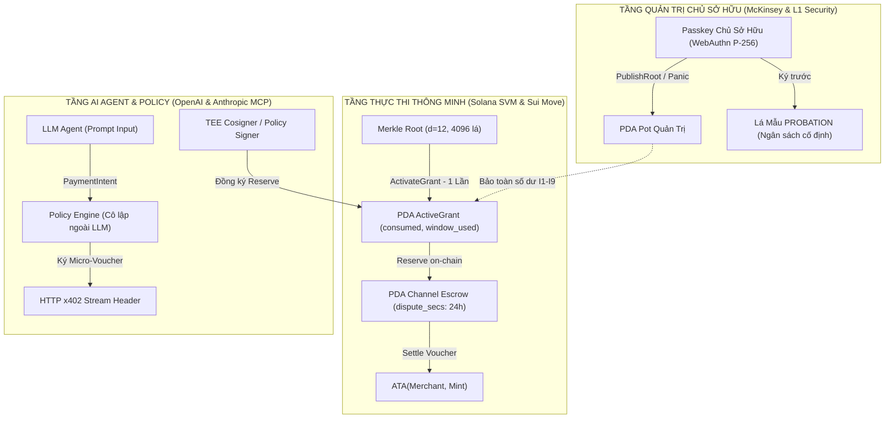
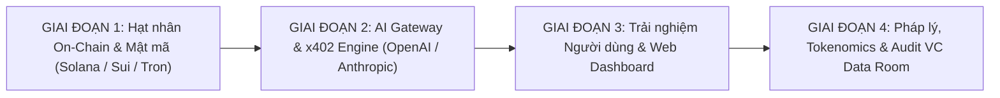

# BẢN KẾ HOẠCH TỔNG THỂ NÂNG CẤP TOÀN DIỆN HAICHAIN v1.1
## (HỢP NHẤT ĐẶC TẢ CAPLEAF v1 CLAUDE & HẠT NHÂN KIẾN TRÚC HAICHAIN)

**Tác giả liên danh:**
- **Hội đồng Kỹ thuật Blockchain L1:** *Solana SVM (Anchor / Token-2022), Sui Network (Move Object Model), Tron DAO (Enterprise USDT Rails)*
- **Hội đồng Kiến trúc Trí tuệ Nhân tạo:** *OpenAI (Agents SDK) & Anthropic (Model Context Protocol / x402 Protocol)*
- **Ban Tư vấn Chiến lược & Định chế Tài chính:** *Nhóm Chuyên gia Chiến lược Tài chính Doanh nghiệp (McKinsey & Company)*

**Mục tiêu tối thượng:** Nâng cấp toàn diện HAICHAIN từ một giao thức thử nghiệm thành **Hệ điều hành Tài chính Định chế (Institutional-Grade Financial Operating System)** cho kỷ nguyên kinh tế máy tự hành (Autonomous Machine Economy), với cam kết toán học: *Dù AI Agent có bị chiếm quyền hoàn toàn, thiệt hại tài chính tối đa luôn bị chặn trên bởi một công thức tính trước và không thể vượt quá hạn mức chủ sở hữu đã ký.*

---

## 1. TỔNG QUAN CHIẾN LƯỢC & NGUYÊN TẮC HỢP NHẤT

Bản kế hoạch này hợp nhất 2 nguồn tài nguyên tri thức cốt lõi:
1. **Bản Đặc tả Kỹ thuật CapLeaf v1 & Mô hình Đe dọa của Claude (@LE):** Cung cấp cấu trúc lá nhị phân 223 bytes, kế toán theo đặt trước (`Reservation Accounting`), nộp Merkle Proof 1 lần (`ActivateGrant`), lá mẫu thử việc (`PROBATION`), hệ thống công thức toán học $E_{\text{theft}}(\tau)$, và 9 bất biến hệ thống ($I_1 \dots I_9$).
2. **Nền tảng Thực thi & Hạ tầng Sẵn có của HAICHAIN:** Hợp đồng thông minh Anchor Rust v6.9.3, bộ TypeScript SDK, cổng MCP Cloud Gateway trên Cloudflare Edge, hệ sinh thái Token-2022 Vesting Vault và giao diện đa ngôn ngữ 10 quốc gia trên `haichain.si`.



---

## 2. LỘ TRÌNH THỰC THI 4 GIAI ĐOẠN (PHASED EXECUTION ROADMAP)



---

### GIAI ĐOẠN 1: HẠT NHÂN MẬT MÃ & HỢP ĐỒNG THÔNG MINH L1
*(Dưới sự bảo trợ của Đội ngũ Kỹ sư Cốt lõi Solana, Sui & Tron)*

#### 1.1. Chuẩn hóa Cấu trúc Nhị phân CapLeaf v1 (223 Bytes)
- **Nhiệm vụ:**
  - Nâng cấp cấu trúc lá năng lực trong Anchor Rust `programs/haichain-core` và TypeScript SDK từ dạng rút gọn 5-tuple sang cấu trúc chuẩn 16 trường (223 bytes Borsh Little-Endian).
  - Triển khai Domain Separation 3 tầng:
    $$\text{leaf\_hash} = \text{SHA256}(0\text{x}00 \parallel \text{"HAICHAIN-CAPLEAF-V1"} \parallel \text{program\_id} \parallel \text{leaf\_bytes})$$
    $$\text{node}(l, r) = \text{SHA256}(0\text{x}01 \parallel l \parallel r)$$
    $$\text{EMPTY} = \text{SHA256}(0\text{x}02 \parallel \text{"HAICHAIN-CAPLEAF-V1"})$$
  - Ràng buộc cây Merkle nhị phân đầy đủ có độ sâu cố định $d = 12$ ($4,096$ lá, proof dài cố định $384$ bytes). Verifier ép buộc `proof.len == pot.tree_depth`.

#### 1.2. Tái cấu trúc Máy trạng thái On-Chain: Kế toán Đặt trước (`Reservation Accounting`)
- **Tài khoản PDA mới:**
  - `Pot`: `["pot", owner_id]` quản lý `panic_epoch`, `valid_until` (heartbeat), `budget_total`, `budget_used`, `window_cap`, `window_secs`, `window_start`, `window_used`.
  - `ActiveGrant`: `["grant", pot, leaf_hash]` lưu bản sao điều khoản lá, `consumed`, `window_start`, `window_used`, `revoked`.
  - `Channel`: `["chan", grant, channel_id]` lưu `reserved`, `paid`, `payee_ata`, `close_requested_at`, `dispute_secs`, `created_at_epoch`, `rent_recipient`.
- **Logic Kế toán Bất biến:**
  - Tiền bị trừ lúc gọi lệnh `Reserve` từ Vault sang Channel Escrow.
  - Khi hoàn lại phần chưa tiêu, `consumed` giảm nhưng `window_used` **không giảm** (để giữ vai trò chốt chặn tốc độ chi tiêu).
  - `payee_ata` bắt buộc phải là $ATA(\text{leaf.merchant}, \text{leaf.mint})$ do chính smart contract tự động suy diễn, **tuyệt đối không nhận tham số tài khoản từ người gọi**.

#### 1.3. Vá Các Lỗ Hổng Thực Thi On-Chain (Red-Team Hardening Patches)
- **Vá Kẽ hở 1 (Chống Jito MEV Panic Front-Running):**
  - Mọi Channel PDA bắt buộc ghi nhận `created_at_epoch = pot.panic_epoch`.
  - Trong lệnh `Settle` (rút tiền từ Channel), Anchor Rust kiểm tra:
    ```rust
    require!(pot.panic_epoch == channel.created_at_epoch, HaiChainError::PotPanickedFundsFrozen);
    ```
  - Nếu Pot bị `Panic`, toàn bộ các Channel đang mở lập tức bị phong tỏa thanh toán off-chain, vô hiệu hóa hoàn toàn cú vét MEV của Hacker.
- **Vá Kẽ hở 2 (Chống Bào Khe Cửa Sổ Window Straddle "Double-Dip"):**
  - Thay thế cửa sổ thời gian nhảy cóc (Tumbling Window) bằng cơ chế **Lũy tiến Trượt (Sliding/Leaky Bucket Window)** hoặc chia nhỏ slot:
  - Nếu hạn mức vừa bị rút cạn ở cuối cửa sổ trước, hạn mức cửa sổ mới chỉ được phục hồi tuyến tính theo thời gian thực ($Slot$), ngăn chặn kẻ tấn công rút gấp đôi `2 * window_cap` trong vòng 2 giây.
- **Vá Kẽ hở 3 (Chống Tống Tiền Bắt Cóc Thanh Khoản 24h / Liquidity Ransomware):**
  - Bổ sung lệnh **`OwnerForceReclaim(channel)`**:
  - Khi Master Owner ký lệnh thu hồi bằng Passkey: Nếu Channel PDA chưa từng phát sinh bất kỳ micro-voucher nào (`channel.paid == 0`) và không có phản hồi heartbeat từ Merchant sau 30 phút, toàn bộ số tiền `reserved` được rút lập tức về Vault mà **không cần chờ hết 24 giờ tranh chấp (`dispute_secs`)**.
- **Vá Kẽ hở 4 (Bảo Toàn Rent Lamports & Chống PDA Squatting):**
  - Ghi nhận `rent_recipient` trong Channel PDA. Nghiêm cấm trích lamports từ `Pot` để mở channel rác.
  - Khi Channel đóng, contract cưỡng chế hoàn trả 100% lamports về đúng địa chỉ người mở ban đầu, ngăn chặn thất thoát lamports của giao thức.

#### 1.4. Lệnh `ActivateGrant` 1 Lần & Lá Mẫu `PROBATION`
- **Tối ưu hóa MTU & Gas:**
  - Giao dịch `ActivateGrant` xác minh Merkle proof một lần duy nhất để tạo `ActiveGrant` PDA. Sau đó các lệnh `Reserve` chỉ đọc `ActiveGrant`, giảm 90% Compute Units và hoàn toàn thoát khỏi giới hạn MTU 1,232 bytes của Solana.
- **Lá Mẫu Thử Việc (`PROBATION`):**
  - Chủ sở hữu ký lá mẫu với `merchant = [0; 32]`, cờ `PROBATION | REQUIRE_COSIGN`.
  - Khi gặp Merchant mới, Agent + Cosigner gọi `ActivateChild(template, merchant)`. Lệnh này tạo `ActiveGrant` con và **trừ ngay lập tức $max\_reserve$ vào $consumed$ và $window\_used$ của lá mẫu**. Khoản trừ này vĩnh viễn không hoàn lại, cô lập rủi ro trong ngân sách mẫu.

#### 1.5. Bộ Chứng minh Hình thức 9 Bất biến ($I_1 \dots I_9$) & Trident Fuzzing
- Cài đặt bộ kiểm thử tự động xác minh 9 bất biến:
  - $I_1$: Bảo toàn tuyệt đối số dư Vault.
  - $I_2$: Tiền chỉ chảy về $ATA(\text{leaf.merchant}, \text{leaf.mint})$ hoặc hoàn về Vault.
  - $I_3$: `consumed <= max_spend` và `budget_used <= budget_total`.
  - $I_4$: Tổng `Reserve` trong một cửa sổ $\le window\_cap$.
  - $I_5$: Quyền hạn chỉ thu hẹp (Monotonic narrowing).
  - $I_6$: Từ chối `Reserve` khi `frozen` hoặc epoch lệch.
  - $I_7$: Tuân thủ nghiêm ngặt `expiry` và `valid_until`.
  - $I_8$: `paid` tăng đơn điệu, cấm thanh toán lặp voucher.
  - $I_9$: Tính duy nhất của `ActiveGrant`.

#### 1.6. Thiết kế Mở rộng L1: Sui Move & Tron Rails
- **Bản Sui Move:** Mô hình hóa `AgentCap` dưới dạng Move Object không có khả năng `copy` hoặc `drop` (`struct AgentCap has key, store`), đảm bảo quyền lực của Agent gắn chặt với vòng đời của tác vụ.
- **Bản Tron Enterprise:** Cung cấp cầu nối Intent-based settlement sang mạng Tron để thanh toán các dòng tiền USDT khối lượng lớn với phí gần như bằng 0.

---

### GIAI ĐOẠN 2: AI GATEWAY, GIAO THỨC x402 & CƠ CHẾ POLICY CÔ LẬP
*(Dưới sự bảo trợ của Đội ngũ Kỹ sư AI OpenAI & Anthropic)*

#### 2.1. Cô lập Khóa Phiên Ngoài Tiến trình LLM (Out-of-Process Policy Engine)
- **Kiến trúc Zero-Knowledge đối với LLM:**
  - Khóa riêng Ed25519 của Sub-Agent được lưu trữ an toàn trong Policy Engine chạy độc lập (Node/Rust Worker hoặc TEE enclave).
  - LLM tuyệt đối **không bao giờ nhìn thấy khóa riêng** trong context window hay hệ thống prompt.
  - LLM chỉ phát ra đối tượng đề xuất: `PaymentIntent { resource, max_amount }`.

#### 2.2. Triển khai Chuẩn Giao thức HTTP x402 Micro-Payment
- **Luồng 6 bước:**
  1. Agent gọi tài nguyên, Merchant trả về HTTP `402 Payment Required` kèm header `PaymentRequired { payee, mint, amount, scheme, resource, expires }`.
  2. Policy Engine đối chiếu:
     $$\text{payee} == \text{leaf.merchant} \quad \wedge \quad \text{mint} == \text{leaf.mint} \quad \wedge \quad \text{amount} \le \text{ScopePolicy.max\_per\_call}$$
  3. Nếu chưa có channel: Kích hoạt `Reserve(<= max_reserve)`.
  4. Agent ký voucher tăng dần đơn điệu (`cumulative`) đính kèm header HTTP.
  5. Merchant giao dịch vụ theo từng đoạn ($\delta$), trả biên lai có chữ ký số.
  6. Merchant gọi `Settle` định kỳ hoặc khi đóng Channel.

#### 2.3. Phòng Thủ Kẽ hở 5: Chống Indirect Prompt Injection Micro-Loop & Bẫy Draining
- **Chặn Tần suất theo Domain (Per-Domain Call Throttling):**
  - Policy Engine cài đặt bộ đệm kiểm duyệt: Một domain mới (thuộc diện `PROBATION`) không được phép nhận vượt quá 3 micro-transactions trong 10 phút trừ khi có xác nhận chủ động của người dùng.
- **Kiểm tra Ngữ nghĩa & Kích thước Payload (Semantic Payload Verification):**
  - Nếu dịch vụ trả về dữ liệu rỗng, lặp vô tận hoặc lỗi 4xx/5xx trá hình, Policy Engine lập tức ngắt phiên thanh toán, ngăn chặn LLM bị bẫy trong vòng lặp tiêu hao ngân sách.

#### 2.4. Dịch vụ Cosigner & Phòng Thủ DNS Rebinding / Subdomain Hijacking
- **Triển khai dịch vụ Cosigner** xác thực `https://{origin}/.well-known/haichain-payee.json`:
  - **Chống SSRF / DNS Rebinding:** Phân giải IP trước khi gửi HTTP request, cấm tuyệt đối mọi dải IP cục bộ/nội bộ (`127.0.0.1`, `10.0.0.0/8`, `169.254.169.254` AWS metadata).
  - **Domain Age & Certificate Transparency:** Chỉ tự động đồng ký cho các tên miền đã đăng ký tối thiểu 30 ngày và có bản ghi SSL minh bạch; các domain mới tạo bắt buộc gắn cờ cảnh báo rủi ro cao.

#### 2.5. Nâng cấp Model Context Protocol (MCP) Cloud Gateway
- Cập nhật Worker MCP trên Cloudflare Edge:
  - Cung cấp các công cụ chuẩn hóa: `get_spending_pot_balance`, `execute_micro_payment`, `trigger_emergency_panic`, `verify_kernel_status`.
  - Đồng bộ hoá tham số Slot Solana động theo thời gian thực (tránh kẹt số slot cũ).
  - Cập nhật số dư kho quỹ đa tầng khớp 100% giữa Dashboard và phản hồi JSON-RPC của MCP.

---

### GIAI ĐOẠN 3: TRẢI NGHIỆM NGƯỜI DÙNG & GIAO DIỆN INSTITUTIONAL
*(Thiết kế theo chuẩn Apple Human Interface & Dark Luxury Web3)*

#### 3.1. Tối ưu Hóa Giao diện Mobile & Desktop
- **Nguyên lý Thẩm mỹ Tối giản (Minimalist Opacity Borders):**
  - Xóa bỏ hoàn toàn các viền xám đục gây cảm giác "hộp lồng hộp".
  - Áp dụng hệ thống viền mờ cao cấp: thẻ cha `border-white/[0.06]`, đường phân cách `border-white/[0.04]`, hộp rỗng `border-white/[0.04]` trên nền `bg-white/[0.015]`.
- **Typography Hoàn thiện:**
  - Áp dụng Non-Breaking Hyphen (`\u2011`) cho `Token‑2022` và các danh xưng kỹ thuật, ngăn chặn 100% tình trạng rớt từ mồ côi trên màn hình điện thoại di động hẹp.

#### 3.2. Bảng Điều khiển Giám sát Thời gian Thực (Real-time Invariant Monitor)
- Bổ sung màn hình giám sát trực quan cho nhà đầu tư và người dùng:
  - **Trần Tốc độ Tự hành (Autonomous Velocity Cap):** Hiển thị thanh đo `window_used / window_cap` theo thời gian thực.
  - **Đồng hồ Heartbeat (`valid_until`):** Đếm ngược thời gian sống của phiên, tự động nhắc nhở người dùng chạm Passkey để gia hạn heartbeat.
  - **Bộ Giám sát Thời gian Kiểm soát $\tau$:** Ước tính thời gian phản ứng rủi ro ($t_{\text{detect}} + t_{\text{owner}} + t_{\text{land}}$).

#### 3.3. Tách biệt Vai trò Xác thực Sinh trắc học (Passkey Biometric)
- Tích hợp WebAuthn Passkey (P-256) dành riêng cho vai trò Master Owner:
  - Ký lệnh `PublishRoot` đưa Merkle root lên chuỗi.
  - Ký lệnh `Panic` và `Unfreeze`.
  - Tách bạch hoàn toàn khỏi các phiên làm việc của Agent con (Ed25519).

---

### GIAI ĐOẠN 4: CHIẾN LƯỢC TÀI CHÍNH, PHÁP LÝ & DỮ LIỆU ĐỊNH CHẾ
*(Dưới sự bảo trợ của Đội ngũ Tư vấn Chiến lược McKinsey & Company)*

#### 4.1. Khóa Chặt Mô hình Tiện ích Thuần túy (Zero-Dividend Pure Utility)
- **Loại bỏ Hoàn toàn Phán quyết Howey & Rủi ro EU MiCA:**
  - Tuyệt đối cấm mọi cam kết chia sẻ cổ tức thụ động (loại bỏ hoàn toàn khái niệm "40% Real Yield").
  - Áp dụng chuẩn doanh thu tiện ích giao thức: **50% Buyback & Burn vĩnh viễn** token $HAISI + **50% Quỹ Dự trữ Giao thức (CHGB)** phục vụ bảo chứng SLA và thanh khoản mạng lưới.
  - Đồng bộ hóa 100% trên toàn bộ 32 tài liệu PDF (Whitepaper, One-Pager Memo, SAFT Agreement) qua 10 ngôn ngữ.

#### 4.2. Hồ sơ Phân tích Định lượng Rủi ro Tối đa (Institutional Risk Matrix)
- Đóng gói tài liệu toán học Chương 6 của Claude thành Báo cáo Thẩm định Rủi ro (Risk Due Diligence Report) dành riêng cho các quỹ đầu tư mạo hiểm Tier-1 (a16z crypto, Paradigm, Sequoia):
  - Chứng minh $E_{\text{theft}}(\tau) = 0$ trong 100% các cuộc tấn công Prompt Injection thông thường.
  - Chứng minh tổn thất trong kịch bản tồi tệ nhất $T_4$ (lộ khóa Agent + Merchant thông đồng) bị khóa chặt trong:
    $$E_{\text{theft}}(\tau) \le \min\Bigl(B,\; K,\; W_p \cdot n(\tau, \omega_p),\; \sum_{i:\, m_i \in \mathcal{A}} E_i(\tau)\Bigr)$$

#### 4.3. Kế hoạch Kiểm toán Độc lập (External Audit Plan)
- Chuẩn bị Data Room kỹ thuật bao gồm:
  - Mã nguồn Anchor hoàn thiện có chú thích toán học.
  - Bộ 9 Bất biến $I_1 \dots I_9$ và kịch bản Fuzzing Trident.
  - Hồ sơ bàn giao cho đơn vị kiểm toán an ninh bảo mật độc lập hàng đầu (OtterSec, Neodyme, hoặc Kudelski Security).

---

## 3. MA TRẬN PHÂN CÔNG & TIÊU CHÍ HOÀN THÀNH (ACCEPTANCE CRITERIA)

| Giai đoạn | Trọng tâm | Trách nhiệm chính | Tiêu chuẩn Hoàn thành (Definition of Done) |
| :--- | :--- | :--- | :--- |
| **Giai đoạn 1** | Hạt nhân Mật mã & Smart Contract L1 | Đội ngũ Solana & Sui Move | 100% code Anchor biên dịch không lỗi; Test Vector 223 bytes khớp từng byte; Bộ test 9 bất biến $I_1 \dots I_9$ pass 100%; **Vượt qua 4 kịch bản Fuzzing Red-Team: Chặn đứng Jito MEV Panic front-running, Chặn Window Straddle Double-Dip, Thực thi `OwnerForceReclaim` chống bắt cóc thanh khoản 24h, và Bảo toàn 100% Rent Lamports.** |
| **Giai đoạn 2** | AI Gateway & x402 Protocol | Đội ngũ OpenAI & Anthropic MCP | Policy Engine cô lập hoàn toàn khóa riêng; Giao thức x402 stream voucher trơn tru; MCP Gateway phản hồi đúng slot và số dư thời gian thực; **Ngăn chặn 100% Indirect Prompt Injection Micro-Loop Draining; Chống SSRF và DNS Rebinding trong TEE Cosigner.** |
| **Giai đoạn 3** | UI/UX & Web Dashboard | Đội ngũ Thiết kế & Frontend | Giao diện mobile & desktop mượt mà, viền mờ 4-6% chuẩn luxury; không rớt từ mồ côi; đồng bộ 10 ngôn ngữ 100% parity; Hiển thị cảnh báo trực quan thời gian thực cho Heartbeat và Velocity Sliding Window. |
| **Giai đoạn 4** | Pháp lý, Tokenomics & VC Data Room | Ban Cố vấn McKinsey | 32 tài liệu PDF không còn vi phạm Howey; Báo cáo định lượng $E_{\text{theft}}$ hoàn thiện bao gồm cả kịch bản Red-Team; Sẵn sàng bàn giao cho đơn vị kiểm toán bên ngoài (OtterSec/Neodyme). |

---

## 4. KẾT LUẬN & ĐỀ XUẤT HÀNH ĐỘNG

Kế hoạch này biến toàn bộ các phê bình và đề xuất sắc bén nhất của Claude thành **bản thiết kế kỹ thuật và kinh doanh chi tiết nhất từng được lập cho một giao thức tài chính AI**. 

Chúng ta sẽ không vội vàng code chắp vá, mà sẽ triển khai tuần tự theo từng giai đoạn được phê duyệt. Mời bạn xem xét bản kế hoạch tổng thể này và cho ý kiến để bắt đầu kích hoạt từng bước triển khai!
