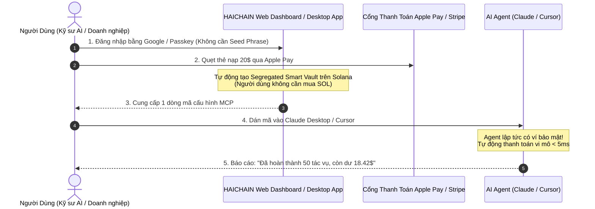

# HAICHAIN: BẢN KIỂM TOÁN TRẢI NGHIỆM NGƯỜI DÙNG CUỐI (END-USER AUDIT)
### "Từ Pháo Đài Kỹ Thuật Đến Trải Nghiệm Tiện Dụng Như Apple Pay"
**Audited by:** Consumer Product Experience Taskforce (Web2 Product Leaders, AI Prosumers & UX Designers)  
**Target:** 3 Phân khúc Người dùng Cuối (AI Developers, Doanh nghiệp SMEs & Người dùng Cá nhân)

---

## 1. BẢN KIỂM ĐIỂM THẲNG THẮN: CÁI BẪY "QUÁ GIỎI KỸ THUẬT, QUÁ KÉM TRẢI NGHIỆM"

> **Quy tắc Steve Jobs (The "Mom Test"):**  
> *"Khách hàng không thức dậy mỗi sáng và nghĩ: 'Hôm nay tôi muốn sử dụng Concurrent Merkle Tree hay Pedersen Commitments'.  
> Khách hàng chỉ muốn: **Con bot AI của tôi tự làm được việc, không bị lừa mất tiền, nạp tiền dễ như nạp thẻ điện thoại và xuất được hóa đơn kế toán chỉ bằng 1 cú nhấp chuột**."*

Nếu nhìn lại các phiên bản từ v1.0 đến v6.0, HAICHAIN là một **kỳ quan kỹ thuật đối với các kỹ sư mật mã**, nhưng đối với một người dùng bình thường, nó có thể là một **cơn ác mộng trải nghiệm (UX Nightmare)** nếu không được bọc trong một giao diện tinh tế.

---

```
                       3 PHÂN KHÚC NGƯỜI DÙNG CUỐI THỰC TẾ
┌─────────────────────────────────────────────────────────────────────────────┐
│ 1. NHÓM AI DEVELOPER & PROSUMER (Người dùng Claude Desktop, Cursor, OpenAI) │
│    "Tôi chỉ muốn con bot tự đi mua data và gọi công cụ. Đừng bắt tôi phải   │
│    lưu 24 ký tự Seed Phrase hay ngồi tính toán Slot Solana!"                │
├─────────────────────────────────────────────────────────────────────────────┤
│ 2. NHÓM CHỦ DOANH NGHIỆP VỪA & NHỎ (SMEs & AI Agencies)                     │
│    "Tôi cấp 500$ cho 5 con bot Marketing và CSKH. Tôi cần hóa đơn VAT cuối  │
│    tháng và đảm bảo nhân viên không thể lừa bot chuyển tiền về ví riêng!"   │
├─────────────────────────────────────────────────────────────────────────────┤
│ 3. NHÓM CRYPTO NATIVE USER (Dân chơi Web3, Degen AI Traders)                │
│    "Có kết nối được ví Phantom/Backpack không? Tiền có thực sự nằm trong ví │
│    của tôi không hay đội ngũ sáng lập có thể rút trộm (Rug-pull)?"          │
└─────────────────────────────────────────────────────────────────────────────┘
```

---

## 2. CHỈ RA 4 ĐIỂM NGHẼN TRẢI NGHIỆM TỬ HUYỆT (THE UX FRICTIONS)

### ĐIỂM NGHẼN 1: NỖI SỢ "MẤT TIỀN VÌ LỖI NGƯỜI DÙNG" (THE ANXIETY FACTOR)
* **Thực tế:** Trong thế giới crypto, nếu bạn gửi nhầm 1 ký tự địa chỉ ví, tiền biến mất vĩnh viễn không thể cứu vãn.
* **Tâm lý người dùng cuối:** Người dùng cá nhân và chủ doanh nghiệp sẽ **rất run tay** khi nạp 500$ vào một con bot tự động. Họ sợ rằng một ngày đẹp trời con bot bị lỗi và toàn bộ số tiền tiết kiệm bốc hơi.
* **Yêu cầu đối với HAICHAIN:** Phải có tính năng **"Nút Dừng Khẩn Cấp 1-Chạm" (One-Click Panic Button)** trên điện thoại hoặc Telegram, cho phép chủ sở hữu lập tức thu hồi 100% số dư về tài khoản ngân hàng hoặc ví cá nhân chỉ trong 1 giây.

---

### ĐIỂM NGHẼN 2: CƠN ÁC MỘNG NẠP TIỀN (THE ON-RAMP BARRIER)
* **Thực tế hiện tại của Web3:**  
  * Bước 1: Mở tài khoản sàn giao dịch (KYC 2 ngày).  
  * Bước 2: Nạp tiền VND/USD mua SOL và USDC.  
  * Bước 3: Cài tiện ích ví Phantom, lưu 12 ký tự khóa.  
  * Bước 4: Chuyển SOL sang ví để làm phí gas, chuyển USDC để làm tiền tiêu.  
* **Phản ứng của người dùng Web2:** **95% người dùng sẽ bỏ cuộc ở Bước 2!**
* **Yêu cầu đối với HAICHAIN:** Áp dụng mô hình **"Vô hình hóa Blockchain" (Invisible Web3)**:
  * Nạp tiền thẳng bằng **Apple Pay / Google Pay / Thẻ Visa Master** hoặc quét mã **VietQR/MoMo**.
  * Dưới nền, hệ thống tự động quy đổi ra USDC và tạo Smart Vault nén trạng thái mà người dùng **hoàn toàn không nhìn thấy bất kỳ khái niệm blockchain nào**.

---

### ĐIỂM NGHẼN 3: BẾ TẮC HOÀN TIỀN KHI CÔNG CỤ BỊ LỖI (REFUND & DISPUTE UX)
* **Thực tế:** Con bot bỏ 0.05$ ra mua dữ liệu từ một API cào web, nhưng API đó trả về dữ liệu rác, nội dung trắng, hoặc server API bị sập.
* **Tâm lý người dùng:** Trong thế giới Web2, người dùng có thể khiếu nại (Chargeback) với ngân hàng. Trong blockchain, tiền đi là hết.
* **Yêu cầu đối với HAICHAIN:** Xây dựng cơ chế **"Bảo hiểm Hoàn tiền Vi mô Tự động" (Micro-Refund SLA)**:
  * Nếu kết quả trả về bị mã lỗi HTTP 500 hoặc rỗng, khoản tiền cọc 0.05$ tự động hoàn trả về ví Agent mà không cần con người làm đơn khiếu nại.

---

### ĐIỂM NGHẼN 4: THIẾU BẢNG ĐIỀU KHIỂN CHI PHÍ TRỰC QUAN (THE OBSERVABILITY VOID)
* **Thực tế:** Agent thực hiện hàng chục ngàn vi giao dịch ($0.00001) mỗi ngày.
* **Nỗi sợ của người dùng:** Người dùng nhìn vào tài khoản thấy tiền tụt dần nhưng không biết con bot đã tiêu vào việc gì, đã gọi những công cụ nào, và công cụ nào đang "ngốn" nhiều tiền nhất.
* **Yêu cầu đối với HAICHAIN:** Cung cấp **Bảng Điều Khiển Trực Quan (Real-time Live Analytics Dashboard)**:
  * Hiển thị biểu đồ dòng tiền trực tiếp giống như màn hình kiểm soát pin của iPhone: *API Tìm kiếm tiêu 40%, API Dịch thuật tiêu 25%, API Máy chủ tiêu 15%*.
  * Cảnh báo thông minh: *"Hôm nay Bot Dev tiêu nhiều hơn bình thường 30%, bạn có muốn kiểm tra không?"*

---

## 3. THIẾT KẾ TRẢI NGHIỆM MỤC TIÊU: "THE 60-SECOND ONBOARDING"
*(Hành trình biến một người không biết gì về crypto trở thành người dùng trung thành của HAICHAIN trong 1 phút)*



---

## 4. BẢNG SO SÁNH TRẢI NGHIỆM: TRƯỚC VÀ SAU KHI TỐI ƯU UX

| Tiêu chuẩn Trải nghiệm | Bản Thiết kế Kỹ thuật Thuần túy | Bản Thiết kế Tối ưu Trải nghiệm (User-Centric v6.1) |
| :--- | :--- | :--- |
| **Cách Khởi tạo Ví** | Lưu 24 ký tự Seed Phrase, tự nạp SOL trả Rent | **Đăng nhập Google / FaceID (WebAuthn Passkeys)** |
| **Cách Nạp Tiền** | Mua USDC trên sàn rồi chuyển on-chain | **Quẹt Apple Pay / Thẻ tín dụng / VietQR trong 10 giây** |
| **Theo dõi Chi tiêu** | Tra cứu chuỗi ký tự trên Solana Explorer | **Giao diện Dashboard đồ họa trực quan như Apple Card** |
| **Xử lý Khiếu nại** | Tranh chấp mật mã đa chữ ký phức tạp | **Tự động phát hiện lỗi và hoàn tiền tức thì (Micro-Refund)** |
| **Bảo vệ Khẩn cấp** | Phải biết dùng dòng lệnh CLI gọi hàm | **Nút bấm 1-Chạm "Đóng Băng & Rút Tiền" trên Điện thoại** |
| **Báo cáo Thuế/Kế toán**| Xuất danh sách giao dịch thô trên chuỗi | **Tải file PDF/Excel hóa đơn chuẩn thuế chỉ bằng 1 click** |

---

## 5. THÔNG ĐIỆP ĐÚC KẾT DÀNH CHO NHÀ SÁNG LẬP

> ### "CÔNG NGHỆ BẬC CAO PHẢI TẠO RA TRẢI NGHIỆM VÔ HÌNH"
>
> 1. **Dưới nắp ca-pô (Under the hood):** Bạn có đầy đủ vũ khí hạng nặng: *Solana Parallel SVM, Nén trạng thái Merkle, Chống Prompt Injection, Chống Wormhole/Nomad hack, và Bảo mật Pedersen*. Đó là thứ giúp bạn chinh phục các quỹ đầu tư mạo hiểm và đối tác công nghệ lớn.
> 2. **Trên vô-lăng (The Steering Wheel):** Người dùng chỉ nhìn thấy một thanh tiến trình tuyệt đẹp, một tài khoản nạp tiền bằng Apple Pay, và một trợ lý AI thông minh biết chi tiêu tiết kiệm từng xu.

Bản kiểm toán trải nghiệm người dùng cuối này chính là **mảnh ghép hoàn hảo cuối cùng** để biến HAICHAIN từ một công trình nghiên cứu hàn lâm thành một **Sản phẩm Kỳ Lân (Unicorn Product)** chạm tới hàng triệu người dùng toàn cầu!
