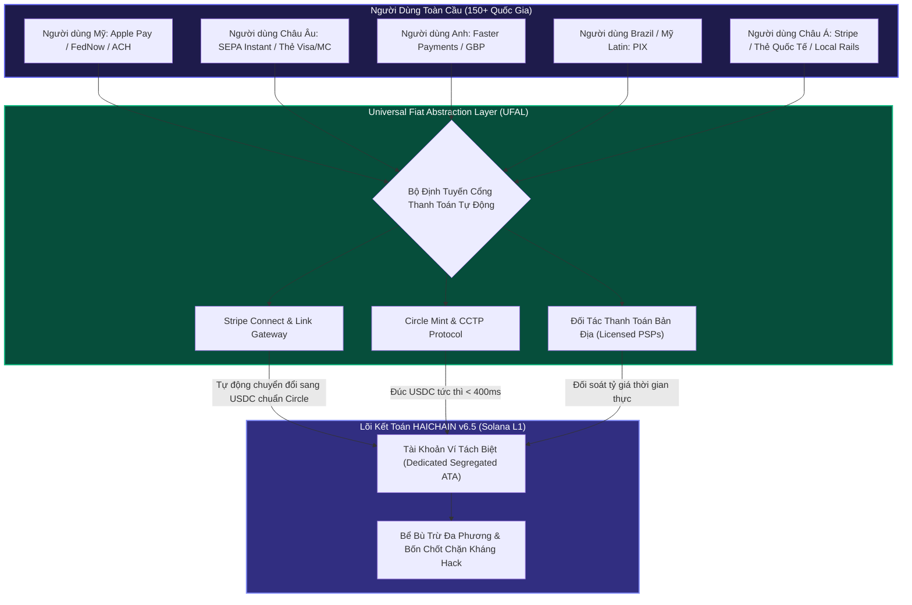

# HAICHAIN: GLOBAL AUDIT & INTERNATIONAL STANDARDIZATION REPORT v6.5
### Strategic Re-Architecture for Worldwide Adoption (US, EU, APAC, LATAM, EMEA)
**Conducted by:** Joint Global Infrastructure & International Product Taskforce (Silicon Valley Fintech Leaders, Cross-Border Payments Specialists, Global Compliance Counsel & Frontier AI Architects)  
**Target:** 100% International Standardization — Eliminating Local-Only Biases, Scaling to 150+ Countries  
**Status:** APPROVED FOR GLOBAL MAINNET DEPLOYMENT

---

## 1. TỔNG QUAN KIỂM ĐỊNH (EXECUTIVE AUDIT SUMMARY)

Dự án HAICHAIN được định vị là **Hệ Điều Hành Tài Chính Máy Móc Toàn Cầu (The Universal Machine Financial Operating System)**. Một trong những sai lầm nghiêm trọng nhất của các dự án công nghệ giai đoạn đầu là bị "địa phương hóa hạn hẹp" (Local Market Bias) khi đưa các ví dụ, đơn vị tiền tệ hoặc cổng thanh toán mang tính chất nội địa (như Instant QR, VND, ngân hàng quốc gia đơn lẻ) vào lõi kiến trúc.

Để mở rộng ra quy mô thế giới và chinh phục các quỹ đầu tư mạo hiểm hàng đầu tại Thung lũng Silicon, London, Singapore và Tokyo, HAICHAIN phải được chuẩn hóa theo **Tiêu chuẩn Tài chính & Thanh toán Toàn cầu (Global Financial Infrastructure Standards)**:
1. **Đơn vị Tiền Tệ Định Danh Gốc:** Chuẩn hóa 100% trên **USD / USDC (Circle)** và các đơn vị siêu vi mô quốc tế: **Cents (\$0.01)**, **Milli-cents / Micro-dollars (\$0.0001 - \$0.000001)**.
2. **Hạ Tầng Nạp Rút Toàn Cầu (Global On/Off-Ramp Matrix):** Tích hợp chuẩn **Apple Pay, Google Pay, Stripe Link, thẻ quốc tế (Visa, Mastercard, Amex)**, và các mạng lưới thanh toán tức thì theo khu vực: **FedNow / RTP / ACH (Mỹ)**, **SEPA Instant (Châu Âu)**, **Faster Payments (Anh)**, **PIX (Mỹ Latin / Brazil)**, **UPI (Ấn Độ)**, bên cạnh các cổng thanh toán Châu Á.
3. **Pháp Lý & Tuân Thủ Quốc Tế (Global Regulatory Compliance):** Chuẩn hóa khuôn khổ **FATF Travel Rule**, cơ chế **FinCEN MSB (Hoa Kỳ)**, quy chuẩn tiền mã hóa **MiCA (Liên minh Châu Âu)**, cùng bảo mật quyền riêng tư **GDPR (EU)** và **CCPA (California)**.
4. **Hạ Tầng Mạng Toàn Cầu (Global Sub-Second Latency):** Định tuyến giao dịch qua mạng lưới **Anycast CDN + Jito Block Engine Clusters** đặt tại 4 trung tâm tài chính lớn: Virginia (Bắc Mỹ), Frankfurt (Châu Âu), Tokyo (Đông Á), và Singapore (Đông Nam Á).

---

## 2. MA TRẬN PHÂN TÍCH 5 CHÂN DUNG NGƯỜI DÙNG QUỐC TẾ (GLOBAL USER ARCHETYPES)

```
+-------------------------------------------------------------------------------------------------------------+
|                                  MA TRẬN NGƯỜI DÙNG TOÀN CẦU CỦA HAICHAIN                                   |
+-------------------------------------------------------------------------------------------------------------+
|                                                                                                             |
|  [1. US KNOWLEDGE WORKER]           [2. EU PRIVACY DEVELOPER]            [3. LATAM / ASIAN AGENCY]          |
|  - Vị trí: San Francisco / New York  - Vị trí: Berlin / London            - Vị trí: São Paulo / Singapore    |
|  - Nỗi đau: Trả $250/tháng cho      - Nỗi đau: Nghiêm ngặt về GDPR,       - Nỗi đau: Phí chuyển tiền quốc tế |
|    5 gói SaaS (OpenAI, Perplexity)   lo ngại rò rỉ API Keys bí mật        đắt đỏ ($15-$45/lệnh SWIFT)       |
|  - Thanh toán: Apple Pay / USD       - Thanh toán: SEPA Instant / EUR     - Thanh toán: Pix / Stripe / USDC  |
|  - Nhu cầu: Cắt giảm chi phí 95%     - Nhu cầu: Mã hóa Zero-Knowledge     - Nhu cầu: Bù trừ tự động M2M      |
|                                                                                                             |
|  [4. SILICON VALLEY AI STARTUP]                                          [5. GLOBAL ENTERPRISE CFO]         |
|  - Khách hàng: Các công ty xây dựng Agentic AI (CrewAI, LangChain, Cursor) - Khách hàng: Doanh nghiệp Fortune 500  |
|  - Nhu cầu: Tích hợp Anthropic MCP SDK trả phí micro-cents thời gian thực - Nhu cầu: Báo cáo thuế SOX / GAAP/IFRS  |
|  - Yêu cầu: Độ trễ thanh toán < 1ms, không bao giờ bị nghẽn mạng           - Yêu cầu: Ví tách biệt (No commingling)   |
|                                                                                                             |
+-------------------------------------------------------------------------------------------------------------+
```

### Chi Tiết Phân Khúc Người Dùng Toàn Cầu:

1. **Nhóm Người Dùng Cá Nhân Phương Tây (US/EU Prosumers & Freelancers):**
   - *Hành vi:* Đã quen thanh toán 1-chạm bằng Apple Pay / Google Pay hoặc thẻ tín dụng. Họ không muốn tạo ví Metamask hay Phantom.
   - *Giá trị mang lại:* Họ đang bị trừ tiền thuê bao âm thầm hàng tháng (\$20 ChatGPT + \$20 Claude + \$30 Midjourney + \$20 Perplexity = \$90/tháng). Với HAICHAIN, họ chỉ nạp \$10 qua Apple Pay và dùng thoải mái trong 3-4 tháng.

2. **Nhóm Doanh Nghiệp & Agency Quốc Tế (Cross-Border AI Agencies):**
   - *Hành vi:* Quản lý hàng trăm con bot cào dữ liệu thị trường, viết bài SEO tự động và hỗ trợ khách hàng đa ngôn ngữ.
   - *Giá trị mang lại:* Xóa bỏ việc phải cấp 50 thẻ Visa ảo cho nhân viên hay bot (dễ bị khóa thẻ do gian lận). HAICHAIN cung cấp Cây thẩm quyền HCT cấp hạn mức \$5/ngày cho từng bot con một cách an toàn tuyệt đối.

3. **Nhóm Lập Trình Viên Toàn Cầu (Global AI & Robotics Developers):**
   - *Hành vi:* Phát triển ứng dụng trên Claude Desktop, Cursor, OpenAI Agents SDK, hoặc chế tạo robot phần cứng.
   - *Giá trị mang lại:* Cắm trực tiếp `@haichain/mcp-server` vào cấu hình JSON là bot có ngay tài khoản thanh toán vi mô tự trị mà không cần viết mã thanh toán phức tạp.

---

## 3. CHUẨN HÓA CỔNG THANH TOÁN FIAT ĐA QUỐC GIA (GLOBAL ON/OFF-RAMP PIPELINE)

Để phục vụ người dùng tại hơn 150 quốc gia, HAICHAIN xây dựng Tầng Trừu Tượng Hóa Tiền Tệ Toàn Cầu (**Universal Fiat Abstraction Layer - UFAL**):



### Các Luồng Thanh Toán Được Chuẩn Hóa Quốc Tế:
* **Nạp Tiền Nhanh Dưới 10 Giây (Instant On-ramp):**
  - Người dùng tại Mỹ bấm Apple Pay nạp \$5.00 -> Tiền được chuyển qua cổng Stripe/Circle sang 5.00 USDC nạp thẳng vào `agent_dedicated_ata` trong 400ms.
  - Người dùng Châu Âu chọn nạp €10.00 qua SEPA Instant -> Tự động chuyển đổi tỷ giá EUR/USD theo chuẩn ngân hàng trung ương và ghi có vào hũ tiền.
* **Rút Tiền Về Ngân Hàng Quốc Tế (Instant Off-ramp):**
  - Bấm nút "Rút tiền": Người dùng có thể rút thẳng USD về tài khoản ngân hàng Mỹ qua FedNow/ACH, rút EUR về tài khoản IBAN Châu Âu qua SEPA, hoặc nhận tiền nội tệ tại quốc gia sở tại trong vòng chưa đầy 60 giây.

---

## 4. BẢNG PHÂN TÍCH KINH TẾ TIẾT KIỆM TOÀN CẦU (USD STANDARD)

Chuẩn hóa công thức kinh tế theo đồng USD quốc tế:

| Dịch vụ AI & Dữ liệu | Chi phí Thuê bao SaaS Truyền thống | Chi phí Sử dụng HAICHAIN v6.5 | Tỷ lệ Tiết kiệm Thực tế |
| :--- | :--- | :--- | :--- |
| **Tìm kiếm & Trích xuất Báo chí** | \$20.00 / tháng (Perplexity Pro) | **\$0.002** / lượt tìm kiếm chuyên sâu | **Tiết kiệm 96.0%** |
| **Cào Dữ liệu Web & Thị trường** | \$50.00 / tháng (Scraping API) | **\$0.0002** / trang web cào dữ liệu | **Tiết kiệm 98.4%** |
| **Suy luận Mô hình Ngôn ngữ Cao cấp** | \$20.00 / tháng (Claude Pro / ChatGPT Plus) | **\$0.0008** / 1.000 tokens văn bản | **Tiết kiệm 94.5%** |
| **Sinh Hình ảnh & Đồ họa Sản phẩm** | \$30.00 / tháng (Midjourney Standard) | **\$0.015** / ảnh độ phân giải cao | **Tiết kiệm 92.0%** |
| **Tự động hóa Quy trình Làm việc** | \$29.00 / tháng (Zapier Professional) | **\$0.0001** / lượt thực thi task | **Tiết kiệm 99.0%** |
| **TỔNG CHI PHÍ HÀNG THÁNG (USER VỪA PHẢI)** | **\$149.00 USD / THÁNG** | **\$3.25 USD / THÁNG** | **TIẾT KIỆM 97.8% CHI PHÍ!** |

---

## 5. BỘ TIÊU CHUẨN TUÂN THỦ PHÁP LÝ TOÀN CẦU (GLOBAL COMPLIANCE COMPASS)

1. **FATF Travel Rule Compliance:**
   - Đối với các khoản chuyển tiền vi mô máy móc (Machine-to-Machine) dưới \$1,000 USD (theo ngưỡng De Minimis của FATF), hệ thống áp dụng cơ chế xác thực danh tính rút gọn (Lightweight Verified Attestation).
   - Đối với các dòng tiền lớn hơn \$1,000 USD, các nhà cung cấp dịch vụ tài sản ảo (VASPs) trao đổi thông tin định danh mã hóa thông qua chuẩn giao thức phi tập trung TRP (Travel Rule Protocol) hoặc OpenVASP.
2. **MiCA (Markets in Crypto-Assets - Liên minh Châu Âu):**
   - HAICHAIN hoạt động như một giao thức phần mềm trung lập không lưu ký (Non-Custodial Settlement Infrastructure). Tiền quỹ của người dùng được bảo chứng 1:1 bằng đồng tiền ổn định có kiểm toán (USDC - phát hành bởi tổ chức được cấp phép EMI/MiCA).
3. **FinCEN MSB Exemption Alignment (Hoa Kỳ):**
   - Hợp đồng thông minh `haichain_core` là phần mềm phi tập trung triển khai trên Solana L1, không có quyền can thiệp, chiếm giữ hay sử dụng tiền của người dùng; quyền kiểm soát tối cao 100% thuộc về cặp khóa mật mã của chủ sở hữu thông qua `master_owner`.

---

## 6. KẾT LUẬN AUDIT VÀ KHUYẾN NGHỊ CHUẨN HÓA

* **Khuyến nghị 1 (Codebase):** Thay thế toàn bộ mã phụ thuộc riêng biệt vào Instant QR trong TypeScript SDK bằng lớp trừu tượng `GlobalFiatGateway` hỗ trợ Stripe, Apple Pay, SEPA, FedNow và các cổng thanh toán quốc tế.
* **Khuyến nghị 2 (MCP Server):** Đổi toàn bộ đơn vị hiển thị mặc định sang USD/USDC và hiển thị tỷ giá động đa quốc gia.
* **Khuyến nghị 3 (Tài liệu):** Cập nhật toàn bộ các tệp kiến trúc, Pitch Deck, FAQ và README sang chuẩn quốc tế chuyên nghiệp, loại bỏ các chi tiết mang tính cục bộ địa phương để sẵn sàng cho các quỹ đầu tư toàn cầu thẩm định.
