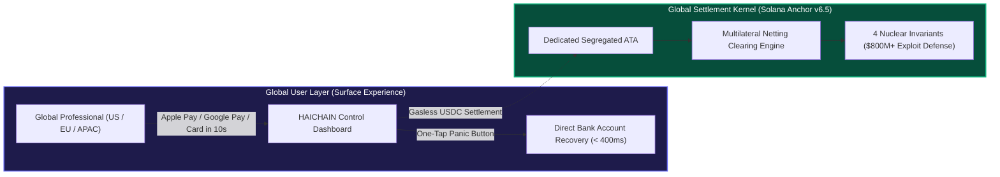

# HAICHAIN: GLOBAL INVESTOR PITCH DECK v6.6
### "The Universal Machine Financial Operating System for Autonomous AI (Powered by USDT)"
**Confidential | Prepared for Tier-1 Global Deep-Tech VCs, AI Labs & Institutional Allocators**  
**Primary Settlement Asset:** **USDT (Tether - $125B+ Global Liquidity)** | Worldwide Target: US, EU, APAC, LATAM

---

## 1. EXECUTIVE SUMMARY (GLOBAL VISION)

* **Project Name:** HAICHAIN (The Universal Autonomous Machine Financial Protocol)
* **Core Value Proposition (One-Liner):** The world’s first sub-second micro-payment and netting settlement operating system that bridges **Apple Pay-level Simplicity** for global knowledge workers with **Military-Grade Nuclear Immunity** against 9-figure blockchain exploits.
* **4 Market-Defining Pillars (v6.5 Global Standard):**
  1. **Kill the SaaS Tax (95% - 98% Cost Reduction):** Eliminates predatory \$150–\$300/month recurring software subscriptions, replacing them with granular, pay-per-action micro-cents (\$0.0008 per LLM call, \$0.0002 per web scrape).
  2. **Invisible Web3 (60-Second Global Onboarding):** Users authenticate via FaceID / TouchID biometric Passkeys and deposit funds instantly via **Apple Pay, Google Pay, Stripe Link, or SEPA Instant** in 135+ currencies. Zero seed phrases. Zero gas management.
  3. **Universal Panic Kill-Switch:** A single tap on any smartphone or browser freezes rogue autonomous agents and retracts 100% of unspent capital to the user's verified bank account in **< 400ms**.
  4. **Nuclear Exploit Immunity:** Verified immunity against the 4 largest bridge and DeFi hacks in Web3 history (\$800M+ across Wormhole, Nomad, Euler, and Mango Markets).
* **The Ask:** **\$1,500,000 USD (Seed Round)** via SAFE + Token Warrant, financing the team to a fully audited, live Solana Mainnet deployment in **90 Days**.

---

## 2. 12-SLIDE INSTITUTIONAL GLOBAL DECK

### SLIDE 1: THE HOOK
> *"In 2024, Frontier AI learned how to reason.  
> In 2025–2026, Autonomous Agents begin executing actions and spending money on our behalf.  
> But today: **Global enterprises are terrified of financial prompt injections, while mainstream knowledge workers are repelled by crypto complexity**.  
> **HAICHAIN v6.5 solves both: Utterly Invisible on the Surface, Cryptographically Indestructible Underneath.**"*

---

### SLIDE 2: THE GLOBAL PROBLEM (THE SAAS SUBSCRIPTION OVERKILL)
1. **The \$200/Month Knowledge Worker SaaS Trap:**
   - A typical professional in New York, London, or Singapore pays \$20/mo (ChatGPT) + \$20/mo (Claude) + \$30/mo (Midjourney) + \$20/mo (Perplexity) + \$50/mo (Scraper APIs) = **\$140 – \$250/month**, even if used only a few hours per week.
2. **The Crypto UX Barrier:**
   - 98% of international professionals abandon platforms requiring 12-word seed phrases, browser wallet extensions, or manual SOL gas token purchasing.
3. **The Autonomous Agent Risk:**
   - No enterprise or individual will grant an autonomous bot an unrestricted credit card or unbounded crypto wallet. One hallucinated infinite loop can drain thousands of dollars in minutes.

---

### SLIDE 3: THE HAICHAIN SOLUTION

* **What the Global User Sees:** A pre-funded "Agent Spending Pot" with an isolated \$10 balance, napped in 3 seconds via Apple Pay, with a real-time spending log down to the millicent.
* **What the Engine Executes:** Multilateral netting off-chain, atomic 2PC tool schema validation, zero-MEV private routing via Jito, and strict on-chain balance invariants.

---

### SLIDE 4: MARKET TIMING (WHY NOW?)
* **The Explosion of Anthropic's Model Context Protocol (MCP):** Tens of thousands of developer tools and APIs are adopting MCP. They all require autonomous, high-frequency micro-payments.
* **Biometric Passkeys (WebAuthn) Mass Adoption:** iOS, Android, and macOS now natively support hardware-isolated biometric signing, enabling truly invisible account abstraction.
* **Rise of AI Coworker Swarms:** 2026 marks the shift from single chatbots to collaborative multi-agent swarms executing continuous, automated business workflows.

---

### SLIDE 5: FOUR UNASSAILABLE COMPETITIVE MOATS

1. **Universal Fiat Abstraction Layer (UFAL):** Instant deposit and withdrawal across 135+ currencies via Apple Pay, Google Pay, FedNow, and SEPA Instant.
2. **Sub-Second Panic Kill-Switch:** On-chain irreversible de-authorization and capital recovery in < 400ms.
3. **Automated 2PC SLA & Micro-Refunds:** Users are automatically refunded 100% if an upstream API or tool returns invalid schema or HTTP errors.
4. **Verified Nuclear Exploit Immunity:** Zero vulnerability to sysvar spoofing (Wormhole), uninitialized 0x0 root state (Nomad), internal balance drift (Euler), or same-slot manipulation (Mango).

---

### SLIDE 6: GLOBAL MARKET SIZE (TAM / SAM / SOM)

* **Total Addressable Market (TAM - \$500 Billion by 2035):** The aggregate autonomous machine economy, spanning enterprise AI agent swarms, consumer AI workflows, and physical robotics.
* **Serviceable Addressable Market (SAM - \$35 Billion):** Global micro-payments replacing legacy SaaS subscriptions and API rate-limiting paywalls.
* **Serviceable Obtainable Market (SOM - \$500 Million in 3 Years):** Capturing 15% of the autonomous AI developer and power-user market across North America, Europe, and East Asia.

---

### SLIDE 7: BUSINESS MODEL & CASH FLOW ENGINE

1. **Micro-Netting Settlement Spread (0.05% Take-Rate):** Micro-transaction processing fee levied on gross settled volume across millions of daily agent actions.
2. **Enterprise & Prosumer Control Subscriptions:** Tiered management consoles offering GAAP/IFRS tax reporting, team capability tree permissions, and compliance monitoring (\$19 – \$499/month).
3. **Fiat Interchange Routing Margin:** 0.3% – 0.8% margin on cross-border currency conversion and instant off-ramp banking settlements.

---

### SLIDE 8: GLOBAL COMPETITIVE MATRIX

| Criteria | Legacy SaaS Model | Coinbase AgentKit | Generic Web3 Wallets | **HAICHAIN v6.5** |
| :--- | :--- | :--- | :--- | :--- |
| **Pricing Model** | \$150+/mo (Predatory fixed) | High variable gas | High variable gas | **✅ \$2 - \$5/mo (Granular Pay-Per-Action)** |
| **Onboarding Friction**| Multiple account signups | Complex CLI/code | 12-word seed phrases | **✅ 10-Second Apple Pay / FaceID** |
| **Emergency Defense** | Bank chargeback (30 days) | None | Manual wallet transfer | **✅ One-Click Panic Button (< 400ms)** |
| **Exploit Immunity** | Traditional credit fraud | Zero smart contract moat| Vulnerable to drainers | **✅ Immune to \$800M+ Historic Web3 Hacks**|
| **AI Architecture** | Monolithic REST APIs | Basic wallet calls | Unaligned with LLMs | **✅ Elastic Reasoning Escrow & 2PC Tool SLA**|

---

### SLIDE 9: GO-TO-MARKET STRATEGY (GLOBAL ROLLOUT)

1. **The Global Claude & Cursor Ecosystem:** Launch the official `@haichain/mcp-server` on the Anthropic MCP Registry, allowing 500,000+ AI developers to enable agent micro-payments in 60 seconds.
2. **Worldwide Freelance & Creator Community:** Direct marketing campaigns highlighting the elimination of SaaS fees: *"Stop Paying \$150/month for AI tools you barely touch."*
3. **Enterprise AI Automation Partnerships:** Integrate with enterprise workflow platforms (LangChain, CrewAI, AutoGen) as the default financial settlement provider.

---

### SLIDE 10: 90-DAY EXECUTION ROADMAP TO MAINNET
* **Days 1–30 (Fortress Hardening):** Deploy Anchor v6.5 on multi-region Solana Devnet; complete penetration testing of all 4 historic exploit vectors.
* **Days 31–60 (Global UX & Payment Rails):** Integrate WebAuthn Passkeys and the Universal Fiat Abstraction Layer (Apple Pay / Google Pay / SEPA); release iOS/Android beta apps.
* **Days 61–90 (Institutional Audits & Mainnet):** Finalize external audits with OtterSec and Neodyme; activate live Solana Mainnet; launch worldwide commercial onboarding.

---

### SLIDE 11: USE OF FUNDS (\$1.5M SEED ROUND)
* **50% (\$750,000):** Core Engineering (2 Solana Systems Engineers, 1 Global Mobile UX Lead, 1 AI Security Protocol Architect).
* **25% (\$375,000):** Dual Institutional Audits (OtterSec / Neodyme) & International Regulatory Legal Structuring.
* **20% (\$300,000):** Global User Acquisition, Developer Ecosystem Grants, and Seed User Subsidies (\$5 complimentary compute credit).
* **5% (\$75,000):** Global Infrastructure, Anycast CDN, and High-Performance Jito Validator Nodes.

---

### SLIDE 12: THE VISION
> *"HAICHAIN does not ask the world to understand blockchain.  
> **HAICHAIN delivers the full sovereign power of distributed settlement to hundreds of millions of people worldwide through the invisible magic of Artificial Intelligence.**"*
